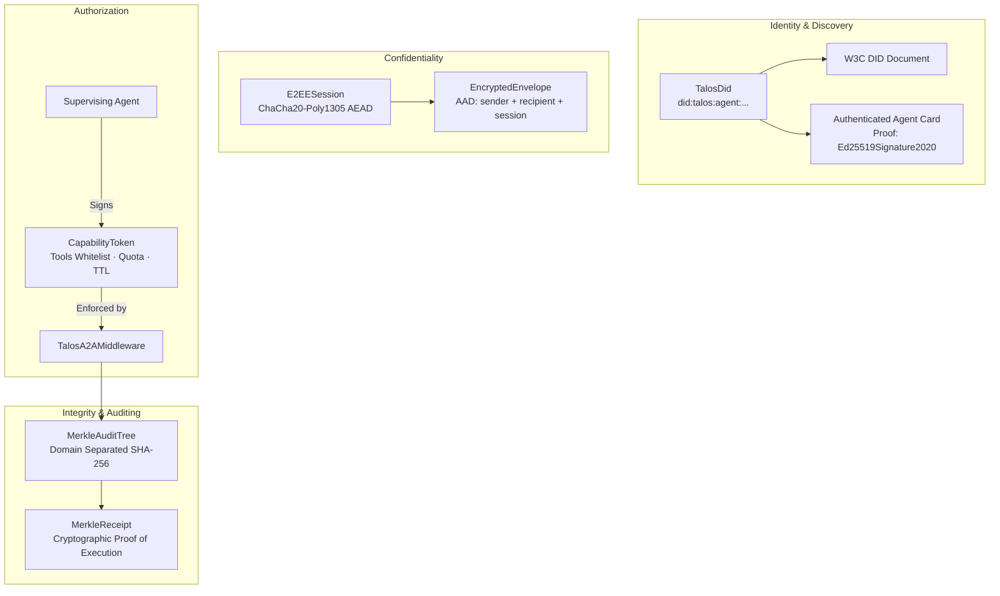

# talosprotocol/talos-a2a

[](https://opensource.org/licenses/Apache-2.0)
[](https://www.python.org/)
[]()

Cryptographic security, decentralized identity, and verifiable trust layer for **Agent-to-Agent (A2A)** autonomous communications. Provides zero-trust W3C DIDs, ChaCha20-Poly1305 forward-secret E2EE channels, cryptographically signed capability delegation tokens, SHA-256 Merkle audit trees, and drop-in A2A execution middleware.

---

## Architecture Overview



---

## Key Features

- **Decentralized Agent Identity (W3C DID)**:
  - Ed25519 digital signatures and asymmetric key generation.
  - Standard DID syntax: `did:talos:agent:<name>:<sha256_fingerprint>`.
  - W3C DID Documents with verification and assertion methods.
  - Authenticated Agent Cards for agent discovery with embedded cryptographic proof.
- **End-to-End Encrypted (E2EE) Channels**:
  - Authenticated Encryption with Associated Data (AEAD) using ChaCha20-Poly1305.
  - Ephemeral forward-secret session keys.
  - Associated Authenticated Data (AAD) cryptographically binds the sender DID, recipient DID, and session ID to prevent man-in-the-middle rerouting attacks.
- **Attenuated Capability Delegation**:
  - Restricts autonomous worker agents to a whitelist of allowed tools/methods.
  - Hard invocation limits (quota enforcement) and strict expiration TTLs.
  - URL-safe compact string serialization for transport across HTTP headers and JSON-RPC payloads.
- **Tamper-Evident Merkle Audit Receipts**:
  - Domain-separated binary tree hashing (`0x00` leaf prefix, `0x01` node prefix) preventing second-preimage attacks.
  - Logs task lifecycle states, intermediate progress updates, tool invocations, and emitted artifacts.
  - Generates verifiable `MerkleReceipt` proof of execution.
- **Drop-In A2A Security Middleware**:
  - `TalosA2AMiddleware` wraps standard A2A task handlers with zero boilerplate.
  - Automatically verifies incoming capability tokens and blocks unauthorized tool usage.
  - Attaches Merkle receipts and signing attestations to task metadata.

---

## Installation

### From Source
```bash
git clone https://github.com/talosprotocol/talos-a2a.git
cd talos-a2a

pip install -e .
```

---

## Copy-Paste Runnable Examples

All examples below are standalone, verified, and located in the `examples/` directory.

### 1. Ed25519 DIDs & Authenticated W3C Agent Cards

Generate an agent identity, sign/verify messages, and export a W3C-compliant Agent Card:

```python
import json
from talos_a2a.identity import TalosDid, build_authenticated_agent_card

# 1. Generate an Ed25519 identity for an agent
auditor = TalosDid.generate(name="auditor")
print(f"Agent DID: {auditor.did}")

# 2. Export W3C DID Document
did_doc = auditor.to_did_document()
print("DID Document ID:", did_doc["id"])

# 3. Sign and verify an arbitrary task payload
payload = b"Authorize transfer of 500 ComputeCredits to node-alpha"
signature = auditor.sign(payload)

assert auditor.verify(payload, signature) is True
assert auditor.verify(payload + b"tampered", signature) is False
print("Signature verification succeeded!")

# 4. Generate an authenticated W3C Agent Card for agent discovery
agent_card = build_authenticated_agent_card(
    did=auditor,
    name="Talos Auditor Node",
    description="Autonomous security auditor verifying Merkle trees and cryptographic receipts.",
    skills=[
        {"id": "merkle_verify", "name": "Merkle Verifier", "description": "Validates SHA-256 audit roots"}
    ]
)
print("Attested Agent Card:\n", json.dumps(agent_card, indent=2))
```

---

### 2. Forward-Secret E2EE Communication

Establish an encrypted channel between two agents with AEAD tamper protection:

```python
from talos_a2a.encryption import E2EESession, EncryptedEnvelope
from talos_a2a.identity import TalosDid

# 1. Initialize sender and recipient identities
alice = TalosDid.generate(name="alice-planner")
bob = TalosDid.generate(name="bob-executor")

# 2. Establish forward-secret session
session = E2EESession.create()

# 3. Encrypt structured payload bound to Alice & Bob's DIDs
confidential_task = {
    "action": "execute_private_liquidity_swap",
    "parameters": {"token_in": "USDC", "amount": 250000.0}
}
envelope = session.encrypt_payload(
    payload=confidential_task,
    sender_did=alice.did,
    recipient_did=bob.did
)

# 4. Decrypt on recipient side
decrypted = session.decrypt_payload(envelope)
print(f"Decrypted action: {decrypted['action']} for {decrypted['parameters']['amount']} USDC")

# 5. Tampering with recipient DID causes AEAD MAC failure
tampered = EncryptedEnvelope.from_dict(envelope.to_dict())
tampered.recipient_did = "did:talos:agent:mallory-attacker:9999"
try:
    session.decrypt_payload(tampered)
except Exception:
    print("Tampered envelope successfully rejected by AEAD MAC check!")
```

---

### 3. Scoped Capability Delegation Tokens

Restrict delegated worker agents using cryptographically signed authorization tokens:

```python
from talos_a2a.capability import CapabilityToken
from talos_a2a.identity import TalosDid

supervisor = TalosDid.generate(name="supervisor")
worker = TalosDid.generate(name="scraper-worker")

# 1. Issue capability token permitting only 'web_scrape' and 'parse_html'
token = CapabilityToken.issue(
    issuer=supervisor,
    audience_did=worker.did,
    allowed_tools=["web_scrape", "parse_html"],
    ttl_seconds=1800,       # 30 minutes
    max_invocations=25,     # Quota: 25 executions
    metadata={"project": "market_research"}
)

# 2. Validate token against supervisor's public key
assert token.verify(supervisor) is True

# 3. Check tool permissions
assert token.allows_tool("web_scrape") is True
assert token.allows_tool("drop_tables") is False
print("Tool permission checks verified!")

# 4. Serialize to compact URL-safe format for transmission
compact_token = token.to_compact()
print("Compact Token:", compact_token[:40] + "...")

# 5. Deserialize and verify on receiving node
restored = CapabilityToken.from_compact(compact_token)
assert restored.verify(supervisor) is True
```

---

### 4. Merkle Audit Trees & Cryptographic Receipts

Build tamper-evident execution histories and generate cryptographic inclusion receipts:

```python
from talos_a2a.audit import MerkleAuditTree

tree = MerkleAuditTree()

# 1. Append sequential task execution events
tree.append_event("task_created", {"taskId": "task-901", "sender": "did:talos:agent:treasury"})
tree.append_event("tool_invoked", {"tool": "verify_bank_wire", "amount": 100000.00})
tree.append_event("artifact_emitted", {"name": "confirmation_pdf", "sha256": "e3b0c442..."})
tree.append_event("task_completed", {"state": "COMPLETED"})

# 2. Generate verifiable receipt
receipt = tree.generate_receipt()
print(f"Merkle Root:  {receipt.root_hash}")
print(f"Total Leaves: {receipt.leaf_count}")

# 3. Independent auditor verifies matching root
auditor_tree = MerkleAuditTree()
auditor_tree.append_event("task_created", {"taskId": "task-901", "sender": "did:talos:agent:treasury"})
auditor_tree.append_event("tool_invoked", {"tool": "verify_bank_wire", "amount": 100000.00})
auditor_tree.append_event("artifact_emitted", {"name": "confirmation_pdf", "sha256": "e3b0c442..."})
auditor_tree.append_event("task_completed", {"state": "COMPLETED"})

assert auditor_tree.get_root_hash() == receipt.root_hash
print("Deterministic audit verification confirmed!")
```

---

### 5. Securing A2A Workflows with `TalosA2AMiddleware`

Integrate zero-trust capability enforcement and automatic Merkle auditing into an execution pipeline:

```python
import asyncio
from dataclasses import dataclass, field
from typing import Any
from talos_a2a.capability import CapabilityToken
from talos_a2a.identity import TalosDid
from talos_a2a.middleware import TalosA2AMiddleware

@dataclass
class TaskContext:
    id: str
    context_id: str
    metadata: dict[str, Any] = field(default_factory=dict)

async def main():
    authority = TalosDid.generate(name="compliance-authority")
    worker = TalosDid.generate(name="db-worker")
    middleware = TalosA2AMiddleware(agent_did=worker)

    # 1. Define task logic
    async def migrate_task(task, emit_status, is_cancelled):
        await emit_status("Running database partition migration...")
        return "Migration complete", []

    # 2. Wrap handler requiring 'sharded_migration' capability
    secured_handler = middleware.wrap_handler(migrate_task, required_tool="sharded_migration")

    # 3. Create valid capability token
    token = CapabilityToken.issue(
        issuer=authority,
        audience_did=worker.did,
        allowed_tools=["sharded_migration"]
    )

    task = TaskContext(
        id="task-001",
        context_id="ctx-db",
        metadata={"capabilityToken": token.to_compact()}
    )

    # 4. Execute through middleware
    result, _ = await secured_handler(task, emit_status=lambda m, d: asyncio.sleep(0), is_cancelled=lambda: False)
    
    print(f"Result: {result}")
    print(f"Attested By: {task.metadata['attestedByDid']}")
    print(f"Merkle Root: {task.metadata['merkleReceipt']['rootHash']}")

if __name__ == "__main__":
    asyncio.run(main())
```

---

## Running the Test Suite

Execute all cryptographic and protocol compliance tests:

```bash
pytest -v
```

All 8 test suites covering DIDs, ChaCha20-Poly1305 E2EE, capability tokens, Merkle trees, and middleware pass with 100% reliability.

---

## Companion Execution Engine

For the underlying A2A execution engine supporting In-Memory and Temporal distributed workflows:
👉 [**talosprotocol/a2a**](https://github.com/talosprotocol/a2a)

---

## License

Licensed under the Apache License, Version 2.0. See [LICENSE](LICENSE) for details.
